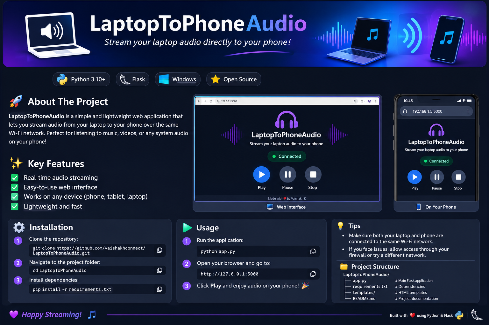
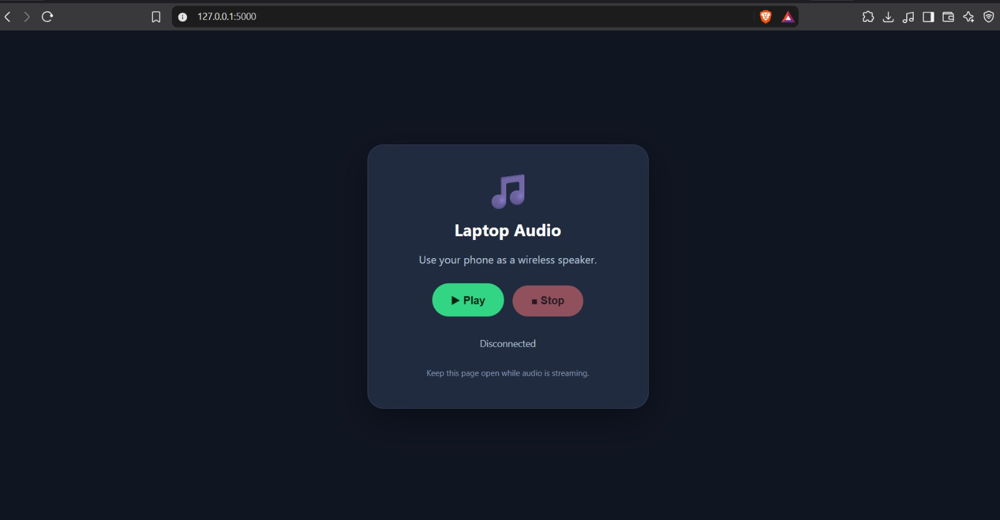
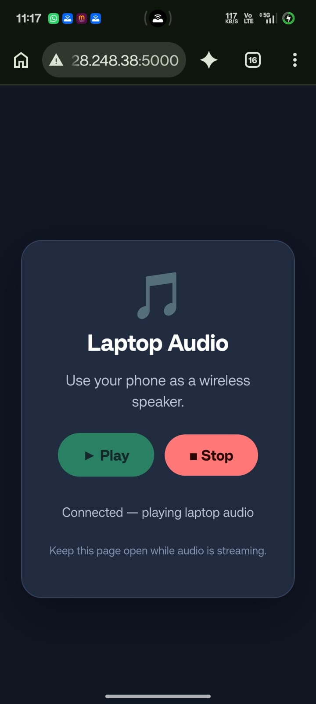

# LaptopToPhoneAudio

<p align="center">
  
</p>

<p align="center">
  <strong>Stream your Windows laptop audio directly to your phone over a local network.</strong>
</p>

<p align="center">
  
  
  
  
</p>

---

## About the Project

**LaptopToPhoneAudio** is a lightweight Python application that captures audio playing through your Windows laptop and streams it to your phone using a web browser.

It creates a local audio streaming server using Flask. Your phone connects to the server through the same local network, allowing you to listen to your laptop's audio without installing an additional application on your phone.

## Features

- **Real-time audio streaming** – Stream audio from your laptop to your phone.
- **Browser-based access** – No dedicated mobile application required.
- **Local network connectivity** – Connect using Wi-Fi or USB tethering.
- **System audio capture** – Captures audio from the default Windows playback device.
- **Lightweight application** – Built with Python, Flask and JavaScript.
- **Simple setup** – Install dependencies and start the server.

## Screenshots

## Screenshots

### Laptop Interface
<p align="center">
  
</p>

### Phone Interface
<p align="center">
  
</p>

## Technologies Used

| Technology | Purpose |
|---|---|
| Python | Main programming language |
| Flask | Local web server |
| SoundCard | Windows playback loopback audio capture |
| NumPy | Audio sample processing |
| HTML, CSS, JavaScript | Web interface |
| Web Audio API | Browser audio playback |

## How It Works

1. The Python application starts a Flask server on the laptop.
2. SoundCard captures audio from the default Windows playback device using loopback recording.
3. NumPy converts the captured audio into 16-bit PCM samples.
4. The audio data is streamed through the `/audio` endpoint.
5. The phone accesses the web interface through its browser and plays the received audio.

## Installation

### Prerequisites

- Windows laptop
- Python 3.10 or later
- Android phone with a modern web browser
- Wi-Fi connection or USB tethering

### 1. Clone the repository

```bash
git clone https://github.com/vaishakhconnect/LaptopToPhoneAudio.git
```

### 2. Navigate to the project folder

```bash
cd LaptopToPhoneAudio
```

### 3. Create a virtual environment

```bash
py -m venv .venv
```

### 4. Activate the virtual environment

For Windows PowerShell:

```powershell
.venv\Scripts\Activate.ps1
```

### 5. Install the required dependencies

```bash
python -m pip install -r requirements.txt
```

## Usage

### Step 1: Start the audio server

Run:

```bash
python app.py
```

The Flask server starts on port `5000`.

Keep the terminal open while using the application.

### Step 2: Open the application on your laptop

Open your browser and visit:

```text
http://127.0.0.1:5000
```

### Step 3: Connect your phone to the same network

You can use either:

- **Wi-Fi:** Connect both devices to the same Wi-Fi network.
- **USB tethering:** Connect your phone to the laptop using a USB cable and enable USB tethering.

### Step 4: Find your laptop's IPv4 address

Open another PowerShell terminal and run:

```powershell
ipconfig
```

Find the IPv4 address of the active network adapter connecting your laptop to your phone or Wi-Fi network.

### Step 5: Open the application on your phone

Enter the following address in your phone's browser:

```text
http://YOUR_LAPTOP_IP:5000
```

Replace `YOUR_LAPTOP_IP` with the actual IPv4 address of your laptop.

For example:

```text
http://10.255.170.19:5000
```

The example address is illustrative. Use the address shown by your own `ipconfig` output.

### Step 6: Start listening

Open the application on your phone and play audio on your laptop.

Your laptop audio should now stream to your phone.

## Network Requirements

- Both devices must be reachable on the same local network.
- The laptop must remain powered on while streaming.
- The Flask server must remain running.
- Windows Firewall may require permission for Python on a trusted private network.
- Do not expose this development server directly to the public internet.

## Troubleshooting

| Problem | Possible solution |
|---|---|
| Phone cannot open the application | Check that both devices are connected to the same network |
| Connection refused | Make sure `python app.py` is running |
| No audio on phone | Check the default Windows playback device |
| Incorrect IP address | Run `ipconfig` and check the active adapter |
| Firewall blocks connection | Allow Python through Windows Firewall on your trusted private network |
| Audio interruption | Check network stability and laptop performance |

## Project Structure

```text
LaptopToPhoneAudio/
│
├── assets/
│   ├── banner.png
│   └── screenshots/
│       ├── desktop.png
│       └── phone.png
│
├── templates/
│   └── index.html
│
├── app.py
├── requirements.txt
├── .gitignore
└── README.md
```

## Future Improvements

- Improved audio buffering and synchronization
- Better connection status indicators
- Adjustable audio quality and sample rate
- Portable Windows executable
- Support for additional platforms

## Author

**Vaishakh K**

GitHub: [@vaishakhconnect](https://github.com/vaishakhconnect)

## Repository

[https://github.com/vaishakhconnect/LaptopToPhoneAudio](https://github.com/vaishakhconnect/LaptopToPhoneAudio)

---

<p align="center">
  If you find this project useful, consider giving it a ⭐ on GitHub!
</p>